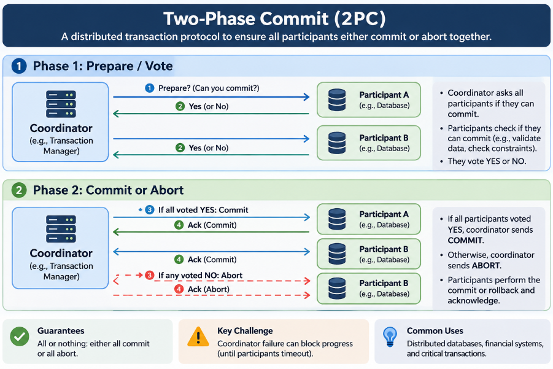

Two Phase Commit (2PC) is a distributed atomic commitment protocol used to coordinate transactions across multiple nodes. It ensures that all participants in a distributed transaction either commit or abort together — maintaining atomicity even when failures occur.

{:class="img-responsive"}

## The Problem

Consider a bank transfer that moves money from Account A on Node 1 to Account B on Node 2. Both nodes must agree on the outcome:

1. **Node 1 debits Account A** — succeeds locally
2. **Node 2 credits Account B** — fails locally

Without coordination, you have money disappearing from Account A without appearing in Account B. 2PC prevents this by ensuring both nodes reach a unanimous decision.

## How Two Phase Commit Works

The protocol involves two roles:

| Role | Responsibility |
|------|---------------|
| **Coordinator** | Drives the protocol, collects votes, makes the final decision |
| **Participant (Cohort)** | Executes transaction work locally, votes on the outcome |

### Phase 1: Prepare (Voting)

1. Coordinator sends a `PREPARE` message to all participants
2. Each participant executes the transaction up to the commit point, acquires locks, but does not commit
3. Each participant replies `YES` (prepared to commit) or `NO` (cannot commit)

### Phase 2: Commit/Abort

If all participants voted `YES`:
- Coordinator sends `COMMIT` to all participants
- Participants release locks and permanently commit

If any participant voted `NO` (or timed out):
- Coordinator sends `ABORT` to all participants
- Participants release locks and roll back

## Go Implementation

Here is a minimal 2PC implementation in Go demonstrating the coordinator and participant pattern.

### Participant

```go
package main

import (
	"context"
	"encoding/json"
	"fmt"
	"log"
	"net/http"
	"sync"
	"time"
)

type Vote string

const (
	VoteYes Vote = "YES"
	VoteNo  Vote = "NO"
)

type TransactionState int

const (
	StateInit TransactionState = iota
	StatePrepared
	StateCommitted
	StateAborted
)

type Participant struct {
	nodeID   string
	mu       sync.Mutex
	state    TransactionState
	prepared bool
}

func NewParticipant(nodeID string) *Participant {
	return &Participant{
		nodeID: nodeID,
		state:  StateInit,
	}
}

func (p *Participant) Prepare() Vote {
	p.mu.Lock()
	defer p.mu.Unlock()

	if p.state != StateInit {
		log.Printf("[%s] Already in state %v, rejecting prepare", p.nodeID, p.state)
		return VoteNo
	}

	// Simulate transactional work: acquire locks, write to undo/redo log
	log.Printf("[%s] Executing transaction work and acquiring locks", p.nodeID)
	time.Sleep(100 * time.Millisecond)

	p.state = StatePrepared
	p.prepared = true
	log.Printf("[%s] Prepared to commit", p.nodeID)
	return VoteYes
}

func (p *Participant) Commit() {
	p.mu.Lock()
	defer p.mu.Unlock()

	if p.state == StatePrepared {
		p.state = StateCommitted
		log.Printf("[%s] Committed transaction", p.nodeID)
	}
}

func (p *Participant) Abort() {
	p.mu.Lock()
	defer p.mu.Unlock()

	if p.state == StatePrepared {
		p.state = StateAborted
		log.Printf("[%s] Aborted transaction", p.nodeID)
	}
}

func (p *Participant) State() TransactionState {
	p.mu.Lock()
	defer p.mu.Unlock()
	return p.state
}
```

### Coordinator

```go
type Coordinator struct {
	participants []*Participant
	timeout      time.Duration
}

func NewCoordinator(participants []*Participant, timeout time.Duration) *Coordinator {
	return &Coordinator{
		participants: participants,
		timeout:      timeout,
	}
}

func (c *Coordinator) Run(ctx context.Context) bool {
	votes := make(chan Vote, len(c.participants))

	// Phase 1: Prepare — send PREPARE to all participants
	for _, p := range c.participants {
		go func(participant *Participant) {
			votes <- participant.Prepare()
		}(p)
	}

	allYes := true
	for i := 0; i < len(c.participants); i++ {
		select {
		case vote := <-votes:
			if vote == VoteNo {
				allYes = false
			}
		case <-time.After(c.timeout):
			log.Println("Prepare phase timed out")
			allYes = false
		case <-ctx.Done():
			return false
		}
	}

	// Phase 2: Commit or Abort
	if allYes {
		log.Println("All participants voted YES — issuing COMMIT")
		for _, p := range c.participants {
			p.Commit()
		}
		return true
	}

	log.Println("Some participants voted NO — issuing ABORT")
	for _, p := range c.participants {
		p.Abort()
	}
	return false
}
```

### Putting It Together

```go
func main() {
	ctx, cancel := context.WithTimeout(context.Background(), 5*time.Second)
	defer cancel()

	p1 := NewParticipant("node-1")
	p2 := NewParticipant("node-2")

	coord := NewCoordinator([]*Participant{p1, p2}, 2*time.Second)
	success := coord.Run(ctx)

	fmt.Printf("Transaction %s\n", map[bool]string{true: "COMMITTED", false: "ABORTED"}[success])
	fmt.Printf("Node 1 state: %v\n", p1.State())
	fmt.Printf("Node 2 state: %v\n", p2.State())
}
```

Sample output:

```
[node-1] Executing transaction work and acquiring locks
[node-2] Executing transaction work and acquiring locks
[node-1] Prepared to commit
[node-2] Prepared to commit
All participants voted YES — issuing COMMIT
[node-1] Committed transaction
[node-2] Committed transaction
Transaction COMMITTED
Node 1 state: 2
Node 2 state: 2
```

## Failure Modes

2PC is not failure-proof. Key failure scenarios:

| Failure | Impact |
|---------|--------|
| **Coordinator crashes after Phase 1** | Participants remain locked in `StatePrepared` indefinitely (blocking) |
| **Participant crashes after voting YES** | Coordinator waits for its `COMMIT`/`ABORT` acknowledgment, may block |
| **Network partition** | Coordinator cannot reach participants; transactions hang until timeout |

This blocking behavior is why 2PC is often avoided in favor of Paxos, Raft, or Saga patterns for high-availability systems.

## When to Use 2PC

Use 2PC when:

- You need **strong atomicity** across multiple services/databases
- Transactions are short-lived (locks held briefly)
- A coordinator crash is rare enough that blocking is acceptable

Avoid 2PC when:

- You need **high availability** (coordinator is a single point of failure)
- Transactions span long durations (lock contention)
- You operate at internet scale (consider Saga, event sourcing, or eventual consistency)

## Summary

2PC trades availability for consistency. It guarantees that distributed transactions commit or abort atomically, but the coordinator can become a blocking single point of failure. For most modern distributed systems, this tradeoff makes 2PC suitable only for tightly-coupled, short-lived transactions within a single administrative domain.
